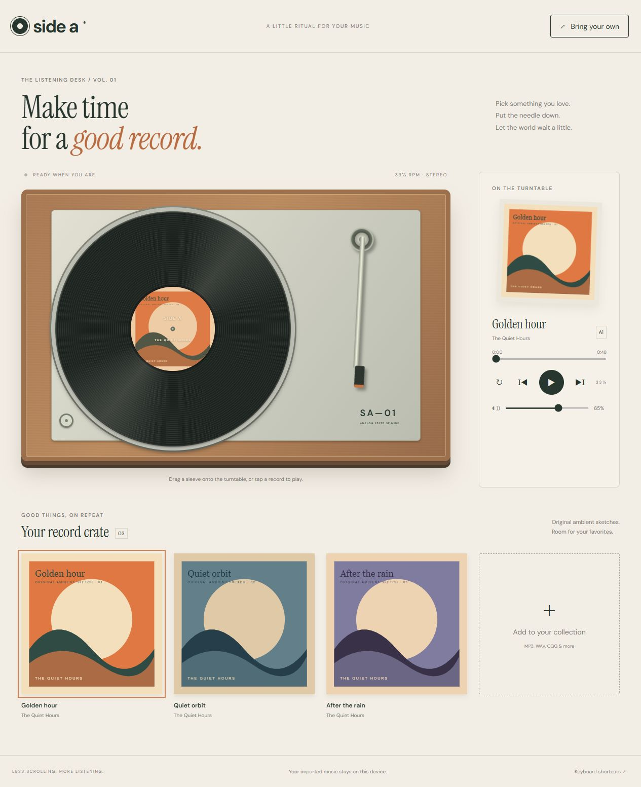

# Side A

**[Open the app](https://4onv.github.io/vinyl-desk/)**

A tactile vinyl player for your own music.



## Run

Requires Node.js 20 or newer. No install, API key, or build step.

```sh
node server.mjs
```

Open http://127.0.0.1:4311. On Windows, double-click `Start.cmd`, then open that address.

```sh
node --test
node --check app.js
```

The browser app is static HTML, CSS, and JavaScript. Deploy `index.html`, the CSS/JS files, and `assets/` to any static host. `server.mjs` is a loopback-only development server.

## Features

- A spinning record, wood turntable, movable needle, and draggable album sleeves.
- Three original 48-second ambient sketches with original cover art.
- Import local audio files; play/pause, previous/next, seek, volume, and repeat.
- Drop audio directly onto the turntable or drag a record from the crate.
- Keyboard controls: Space to play/pause, arrows to seek by five seconds.
- Responsive layout and reduced-motion support.

## Local audio

Audio files are played using temporary browser object URLs. They are never uploaded and must be selected again after closing or reloading the tab. Actual format support depends on your browser. There is no Spotify or Apple Music integration.

## Design and assets

All illustrations, album artwork, and demo audio in this repository were created for this project. Google Fonts provides DM Sans and Instrument Serif with system-font fallbacks when offline. No runtime JavaScript dependencies.

## Validation

`node --test` checks app resources, static serving, HTTP range requests, and domain behavior. GitHub Actions runs the same suite. Manual browser checks cover playback/controls, layout, and relevant live API flows.
